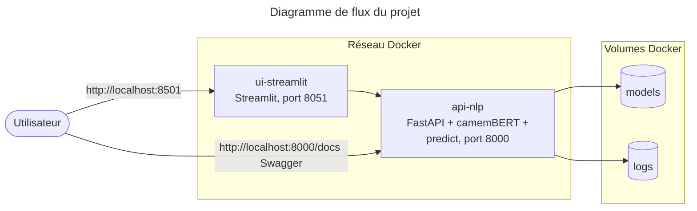
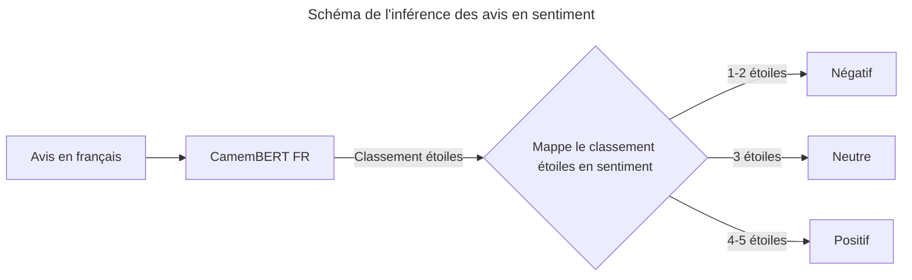

# Analyse
Voici l'analyse de la stack.

## Partie 1 

### Schéma d'architecture Mermaid




### Comment lancer la stack
    #Lancement du Docker et création/lancement des images et containers

```bash
# 0. Clone le repo du binôme et crée ta branche
git clone git@github.com:bcoste45/M0-B2-sentiment-blanche.git
cd M0-B2-sentiment-blanche

# 1. Configurer l'environnement (Docker Desktop : au moins 6 Go de mémoire
#    alloués, sinon le conteneur de l'API est tué sans message)
cp .env.example .env

# 2. Construire et lancer la stack
docker compose up --build

# 3. Vérifier (dans un autre terminal)
curl http://localhost:8000/health        # API NLP
# UI Streamlit : ouvre http://localhost:8501 dans ton navigateur
```

Pour arrêter la stack : ` docker compose down `

## Partie 2
### Analyse de 3 avis au moins
Afin de faire la comparaison du sentiment prédit et prévu des avis de sample_reviews.csv, j'ai ajouté une partie au Swagger où en donnant le csv, est affiché en clair la comparaison.
Il y a en tout 5 avis notés différemment entre la prédiction et l'attente.

| id | Avis | Sentiment attendu | Sentiment prédit |
|---|---|---|---|
| 4 | "Chambre superbe avec vue sur le port mais petit-déjeuner décevant et service très lent." | Neutre | Négatif |
| 7 | "Pas mauvais du tout, on s'attendait à pire vu les avis. Bonne surprise sur le rapport qualité-prix." | Positif | Neutre |
| 9 | "Établissement standard, conforme à la description. Rien à signaler de particulier." | Neutre | Positif |
| 12 | "On a passé un séjour qu'on n'oubliera pas. La climatisation en panne en plein août, sympa." | Négatif | Positif |
| 18 | "Séjour neutre, sans plus. Le personnel fait son travail, l'hôtel sa fonction. Rien de mémorable." | Neutre | Négatif |

L'avis n°4 est mixte, le client a relevé des bonnes et mauvaises choses, l'on peut estimer neutre mais  la prédiction a plutôt vu un point positif pour deux négatifs.   
Les avis n° 9 et 18 sont neutres, mais les remarques à la fin ont fait penché la balance  pour l'un vers le positif et l'autre vers le négatif.   
L'avis n°12 est clairement ironique. 

## Partie 3
### Justification du mapping 
Le mapping symétrique regroupé (4-5 étoiles => positif, 3 étoiles => neutre, 1-2 étoiles négatif) permet de prendre assez large les avis positifs et négatifs. En effet, certaines personnes, même si tout est parfait, ne mettront jamais 5 mais s'arrêteront à 4. Et inversement, les gens déçus auront tendance à mettre facilement 1 étoile, mais étant donné que ce sont ces avis qui nous intéressent (afin de mettre en lumière les problèmes et défauts), ils vaut mieux ratisser large. 


